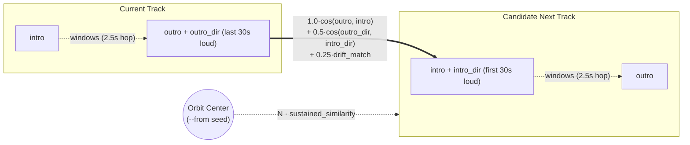

# echo-control

Walk a local music library along smooth trajectories in audio embedding space.

Every track is sliced into overlapping windows, embedded with
[CLAP](https://huggingface.co/laion/larger_clap_music_and_speech)'s audio tower, and stored in
Qdrant along with its intro and outro positions, headings, and drift rates. Starting from a seed
track (`--from`), `vibe` chains tracks whose intro picks up where the previous outro left off—matching
seam position, direction of movement, and pace. With `--orbit`, the walk is pulled back toward the
seed so it circles a vibe instead of drifting off into the weeds.

```bash
# Walk 25 tracks from a seed file, matching outro -> intro transitions
vibe --wander --from ~/Music/album/opener.flac

# Orbit the seed track (strength 1.0 by default) so the walk stays anchored to its vibe
vibe --orbit --from ~/Music/album/opener.flac

# Endless walk in mpv, keeping 3 tracks queued ahead over mpv's IPC socket
vibe --continuous --orbit=1.5 --from ~/Music/album/opener.flac
```

Tags and metadata are never read; transitions and similarity come purely from how the audio moves
through embedding space. You can also pass a text query instead of `--from` to pick an initial seed
or orbit center (e.g. `vibe --orbit "sad synth"`), though CLAP's language model is pretty weak—it's
fine for picking a rough starting point, but audio-to-audio trajectory matching is where this
actually shines.

### Example Walk

Starting an orbit (`--orbit=1.0`) from Hybrid's *Steal You Away* (`Morning Sci-Fi`, 2003) jumps
across 70s synth-rock (*Quadrophenia*), Bristol trip-hop, progressive breaks, world-fusion, and
prog metal—stuff you probably wouldn't think to put on the same playlist, but the seams lock right
in:

```bash
vibe --orbit -n 10 --from ~/Music/"Hybrid/Morning Sci-Fi/09 Steal You Away.mp3"
```

| # | Track | Album | Seam (`pos`) | Heading (`dir`) | Pace (`drift`) | Orbit (`ctr`) | Total |
| --: | --- | --- | --: | --: | --: | --: | --: |
| 1 | [Hybrid – *Steal You Away*](https://www.youtube.com/watch?v=0F76LgpKQcg) | *Morning Sci-Fi* | — | — | — | — | seed |
| 2 | [The Who – *The Rock*](https://www.youtube.com/watch?v=R-XiVtp2ISg) | *Quadrophenia* | `+0.74` | `+0.29` | `-0.09` | `+0.75` | **`+1.62`** |
| 3 | [Portishead – *Sour Times*](https://www.youtube.com/watch?v=un8EW82GwKc) | *Dummy* | `+0.68` | `-0.05` | `-0.16` | `+0.86` | **`+1.48`** |
| 4 | [Portishead – *Glory Box*](https://www.youtube.com/watch?v=4qQyUi4zfDs) | *Dummy* | `+0.80` | `-0.03` | `-0.14` | `+0.74` | **`+1.49`** |
| 5 | [Portishead – *It Could Be Sweet*](https://www.youtube.com/watch?v=Aw8GucJ4f7E) | *Dummy* | `+0.77` | `+0.29` | `-0.38` | `+0.65` | **`+1.47`** |
| 6 | [Sneaker Pimps – *Grazes*](https://www.youtube.com/watch?v=SO_PYTFgHIg) | *Bloodsport* | `+0.73` | `+0.10` | `-0.28` | `+0.70` | **`+1.41`** |
| 7 | [BT – *Dark Heart Dawning*](https://www.youtube.com/watch?v=5q3Uyze7GGg) | *Emotional Technology* | `+0.75` | `+0.10` | `-0.23` | `+0.76` | **`+1.50`** |
| 8 | [Delerium – *Duende*](https://www.youtube.com/watch?v=046uwk0miGU) | *Karma* | `+0.70` | `+0.17` | `-0.19` | `+0.75` | **`+1.49`** |
| 9 | [Tulku – *Anni Rose*](https://www.youtube.com/watch?v=6c7dDgYuap4) | *Trancendence* | `+0.83` | `+0.14` | `-0.33` | `+0.77` | **`+1.58`** |
| 10 | [Dream Theater – *Trial of Tears*](https://www.youtube.com/watch?v=R8XgP8C2oqU) | *Falling Into Infinity* | `+0.72` | `+0.39` | `-0.00` | `+0.58` | **`+1.50`** |

▶ [**Listen to this 10-track walk as a YouTube playlist**](https://www.youtube.com/watch_videos?video_ids=0F76LgpKQcg,R-XiVtp2ISg,un8EW82GwKc,4qQyUi4zfDs,Aw8GucJ4f7E,SO_PYTFgHIg,5q3Uyze7GGg,046uwk0miGU,6c7dDgYuap4,R8XgP8C2oqU)

- **Cross-genre seams (`1 -> 2` and `9 -> 10`):** *Steal You Away*'s synth-and-strings outro hands
  off straight into *Quadrophenia*'s *The Rock* (`pos = +0.74`, `dir = +0.29`, nearly identical
  pace `drift = -0.09`). At the end, *Tulku*'s *Anni Rose* flows into the rain-and-clean-guitar
  intro of Dream Theater's *Trial of Tears* with an exact pace match (`drift = -0.00`) and aligned
  heading (`dir = +0.39`).
- **Album gravity (`3 -> 4 -> 5`):** Once *The Rock* lands on *Portishead – Sour Times* (pulled in
  by a `+0.86` orbit match to the seed), *Dummy*'s dusty vinyl/vocal mastering is so cohesive that
  three tracks chain in a row (`+0.80` into *Glory Box*, `+0.77` into *It Could Be Sweet*) before
  *It Could Be Sweet*'s outro bridges out to *Sneaker Pimps* and *BT*.

## Setup

```bash
uv tool install --editable .          # installs `vibe` and `echo-control` into ~/.local/bin
echo-control install-service          # writes config.toml, docker-compose + systemd user units
# edit ~/.config/echo-control/config.toml to set [library] paths
systemctl --user enable --now echo-control
echo-control status
```

Requires Docker (system `docker.service` enabled, user in the `docker` group).
The first scan is slow on CPU; watch it with `journalctl --user -fu echo-control`.

## Wandering & Orbiting (`[wander]`)



With the default `chunks` strategy, each track in `<collection>_tracks` stores:
- **`intro`, `outro`, `intro_dir`, `outro_dir`:** Position and unit tangent heading over the first
  and last `edge_seconds` (30s) of full-level audio. Leading/trailing silence and windows more than
  12 dB below the track's median loudness are skipped so fade-outs don't all look like the same
  fade-out. Headings are the least-squares slope of the window vectors over time, projected onto the
  sphere's tangent plane so window-to-window jitter cancels out.
- **`intro_drift`, `outro_drift`:** How fast the track is moving through embedding space at each
  edge.
- **`mean`** (over non-silent windows) and **trajectory stats:** `speed_mean`, `speed_std`,
  `spikes` and `spike_times` (likely section changes), `tortuosity`, and `intro_len`.

At each step of `vibe --wander`, the `candidates` (100) tracks whose `intro` is closest to the
current track's `outro` are scored by:

```text
position * cos(outro, intro)
+ direction * cos(outro_dir, intro_dir)
+ drift * -|log((outro_drift + eps) / (intro_drift + eps))|
```

with defaults `position = 1.0`, `direction = 0.5`, `drift = 0.25`.

### Orbiting (`--orbit[=N]`)

Plain `--wander` follows local `outro -> intro` seams wherever they lead, which eventually wanders
off into unrelated corners of the library. `--orbit[=N]` (`N = 1.0` by default) adds a pull back
toward a fixed center (the `--from` seed track, or a text query):

- Adds `N * center_similarity` to each candidate's score (using the sustained-window similarity).
- Injects the `candidates` tracks closest to the center into the pool at every step, so the walk
  can bend back even if every intro near the current outro has drifted far away.

### Duplicate Detection

Walks skip tracks with no audible windows, and never play another copy of a track already in the
walk. If a candidate's `mean` or `intro` is at least `duplicate_similarity` (0.95) close to a
played track's, their window sequences are aligned in time (up to 20s of offset) over the stretch
they share. An alignment of at least `duplicate_alignment` (0.92) counts as the same recording:
- Re-encodes, remasters, compilation tracks, and truncated files line up window-for-window at
  `~0.94–1.0` and get skipped.
- Different tracks from the same album that just share a mix/master score around `~0.86–0.87` and
  stay eligible.

## Commands

- `vibe --wander --from FILE` (or `vibe --wander "<query>"`) chains tracks from `FILE` (or the top
  query hit). Requires `[model] strategy = "chunks"` (the default).
- `vibe --orbit[=N] --from FILE` (or `vibe --orbit[=N] "<query>"`) wanders with a pull of strength
  `N` (default `1.0`; `0` is plain `--wander`) toward `FILE` or the query.
- `vibe --continuous ...` wanders indefinitely in `mpv`, keeping 3 tracks queued ahead of the
  current track over mpv's JSON IPC socket. Quit `mpv` to stop, or pass `--detach` to run it in the
  background.
- `vibe "<query>"` runs a direct text-to-audio search and plays the top matches.
- Common `vibe` flags: `-n/--limit`, `--player {mpv,spotatui,command,stdout}`, `--shuffle`,
  `--print` (M3U to stdout), `--json`, `--detach`, `--play-path FILE...`. Piping stdout automatically
  outputs an M3U instead of launching a player.
- `echo-control daemon` runs the `inotify` watcher and local socket. Scans and file changes run in a
  short-lived child process that loads the GPU encoders and exits so ROCm's runtime thread doesn't
  spin on a CPU core between scans.
- `echo-control scan` runs a one-off index pass without the daemon.
- `echo-control reindex` drops the current strategy's index and rebuilds it.
- `echo-control status` shows daemon, Qdrant, and index state.
- `echo-control install-service` / `install-noctalia` install systemd user units and the Noctalia
  launcher plugin.

## Indexing Strategies

`[model] strategy` sets how a track is turned into vectors. Changing it (or its parameters)
re-embeds the library on the next scan. `chunks` uses `<collection>_chunks` and
`<collection>_tracks`, so switching between `chunks` and `clusters`/`mean` leaves the other index
alone.

| strategy | stored per track | good for |
| --- | --- | --- |
| `chunks` (default) | every `window_seconds` window at `hop_seconds` steps, plus track edges & trajectory | `--wander`, `--orbit`, `--continuous`, sustained search |
| `clusters` | up to `max_clusters` k-means centroids of `window_seconds` chunks | lighter indexing, section-level search |
| `mean` | one vector averaged from `windows` clips | fast indexing, coarse matches |

Shared settings: `window_seconds` (10), and `silence_db` (-45: quieter clips are dropped, or
flagged under `chunks` so window positions stay evenly spaced).

- **`chunks`**: embeds a `window_seconds` window every `hop_seconds` (2.5) into
  `<collection>_chunks` with its `idx`/`total`, `start`/`end` (seconds), `db`, `silent`, and `speed`
  (rad/s travelled since the previous window). Direct search ranks tracks by the mean similarity of
  their best `round(sustain_seconds / hop_seconds)` (`[search] sustain_seconds` = 60) non-silent
  windows.
- **`clusters`**: embeds consecutive `window_seconds` chunks (subsampled to `max_chunks` = 60 on
  long tracks), k-means clusters them into up to `max_clusters` (4) centroids covering at least
  `min_cluster_share` (0.12) of the track, and merges centroids closer than `merge_threshold`
  (0.85). Optional `[search] share_weight` (0) re-ranks by `similarity * share ** share_weight`.
- **`mean`**: averages `windows` (3) clips sampled evenly between 10% and 85% of the track into a
  single vector.

## Noctalia

`echo-control install-noctalia` registers `contrib/noctalia` as a local plugin source and enables
`case/vibe`. In the launcher, type `/vibe <query>`.

## GPU

`torch` is pulled from PyTorch's ROCm 7.2 index (see `[tool.uv.sources]` in `pyproject.toml`), so
AMD GPUs work out of the box with `device = "auto"` (ROCm reports as `cuda`). `triton-rocm` is a
direct dependency because `uv` only applies custom indexes to direct dependencies. For CPU-only
machines, point the index at `https://download.pytorch.org/whl/cpu` and drop `triton-rocm`.
